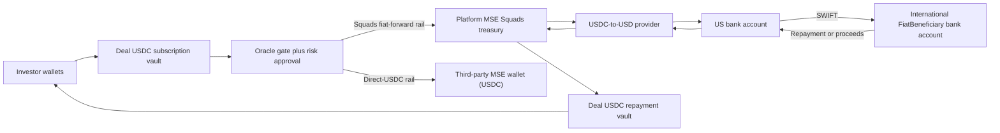

# RWA Tokenization V1 architecture

## 1. Operating model

The US C-Corporation issues every offering. Each deal locks exactly one **MSE
beneficiary** as its release destination, drawn from a governance-registered
registry, and the beneficiary's `rail_kind` decides how released USDC reaches it:

| Role | V1 assignment | What it does |
|---|---|---|
| `Issuer` | US C-Corporation | Creates the legal offering and issues the receipt instrument. |
| `PlatformTreasury` | US C-Corporation authority (`platform_treasury_authority`) | Proposes releases and, on the Squads rail, runs the off-chain USD conversion and SWIFT forward. |
| `Servicer` | US C-Corporation | Reconciles movements, repayment, and investor servicing. |
| `MSE beneficiary` | Platform's own MSE **or** a third-party MSE | The deal's release destination. See the two rails below. |

Two rails, selected per MSE at registration:

- **`SQUADS_FIAT_FORWARD`** — the platform's own MSE. Released USDC lands in a
  US-controlled Squads treasury vault; the platform converts to USD and forwards
  it over SWIFT to the international beneficiary. This rail runs the full
  conversion → SWIFT → bank-confirmation → reconciliation evidence chain.
- **`DIRECT_USDC`** — a third-party MSE. Released USDC is transferred straight
  from the deal's subscription vault to the MSE's registered wallet when the
  oracle approves. There is no conversion or SWIFT leg; the finalized on-chain
  transfer is itself the reconciliation evidence.

The release proposer (`platform_treasury_authority`) is decoupled from the
destination, so a third-party MSE is a passive recipient and never signs releases.
`beneficiary_entity_hash` is the opaque reference to the deal's MSE beneficiary;
`issuer_entity_hash`, `mse_wallet_owner`, `mse_usdc_ata`, and
`servicer_entity_hash` identify the remaining roles.



On the Squads rail, an on-chain release proves receipt by the platform MSE
treasury only — conversion and beneficiary receipt require the treasury-movement
evidence chain in [the rail runbook](TREASURY_RAIL_RUNBOOK.md). On the direct rail,
the on-chain release is receipt by the MSE.

## 2. System boundaries

### Solana

Three upgradeable Anchor programs divide authority and blast radius:

- `pod_oracle` publishes append-only T1/T2/T3 attestations, commodity and FX
  valuations, and deal-gate revisions. A correction creates a successor
  revision; published revisions remain immutable.
- `pod_compliance` manages opaque investor records, wallet bindings,
  series-specific permissions, the Token-2022 transfer hook, governed burns,
  and delayed, balance-preserving wallet recovery.
- `pod_vault` locks deal terms, isolates subscription and repayment custody,
  mints receipts for accepted subscriptions, schedules and releases tranches,
  records treasury movements, accepts repayment USDC, fixes the settlement
  waterfall, and redeems receipts.

`pod-rwa-common` supplies schema versions, shared enums, domain-separated
hashing, basis-point arithmetic, coupon calculation, and floor-based pro-rata
division.

### AWS and applications

- Cognito provides invitation-only application identity and separate
  `TREASURY`, `RISK`, and `COMPLIANCE` operator groups.
- AppSync exposes wallet binding, deal and position reads, disbursement
  workflow commands, and reverse repayment records.
- DynamoDB is an indexed mirror. It MUST NOT override a finalized Solana token
  balance or account.
- Full beneficiary instructions, UETRs, provider receipts, bank confirmations,
  and identity records remain encrypted in the approved AWS evidence store.
  Only domain-separated SHA-256 commitments, statuses, and non-sensitive
  accounting fields are anchored or mirrored.
- The investor application binds a Cognito identity to a wallet through an
  origin-, wallet-, cluster-genesis-, program-, nonce-, and expiry-scoped
  signed challenge.

The implementation locations are indexed in [README.md](README.md).

## 3. Deployment identity

Every client and service MUST load a signed deployment manifest and verify:

1. cluster and genesis hash;
2. all three program IDs;
3. settlement mint, token program, and decimals;
4. protocol, treasury, risk, and guardian authorities;
5. program binary and IDL hashes; and
6. source commit and manifest signature.

The devnet manifest uses Circle's official six-decimal devnet USDC mint
`4zMMC9srt5Ri5X14GAgXhaHii3GnPAEERYPJgZJDncDU`. A settlement instruction
MUST reject any mismatch in mint, token program, decimals, owner, or exact
destination token account.

Devnet runs the real programs, account schemas, Token-2022 controls, Squads
authorities, evidence commitments, and state machines. Mainnet configuration
MUST be produced from the same manifest schema and release pipeline.

## 4. Product model

### Deal

A `Deal` is one legal financing offering and season. Before opening,
`DealTerms` locks:

- issuer, servicer, FiatBeneficiary, and asset-set commitments;
- legal document, source financing contract, terms, oracle policy, compliance
  policy, and approved bank-route commitments;
- commodity and FX valuation references;
- settlement mint, token program, decimals, and isolated vaults;
- exact issuer Squads treasury owner and USDC associated token account;
- servicer, risk, and compliance authorities;
- subscription, maturity, recovery, and claim deadlines;
- minimum raise, hard cap, coupon, explicit fees, release delay, and milestone
  count.

Terms are immutable after subscription opens. A changed legal or economic term
creates a new deal or a governed successor schema; it never silently mutates an
active offering.

### Series and receipt mint

V1 creates one senior `Series` per deal. Its Token-2022 mint MUST have:

- transfer hook;
- default account state frozen;
- permissioned burn;
- an external governed recovery Squads address as `PermanentDelegate`; and
- metadata pointer.

Initial transfer policy is `IssuerRestricted`. Direct investor-to-investor
transfers fail. The existing mint can later use `EligiblePeer`, allowing only
wallets with active bindings and unexpired series permissions. A holder cannot
burn supply unilaterally; refunds, redemptions, and restricted redemptions use
the governed burn path. The Token-2022 `PermissionedBurn` authority is the
`pod_compliance` `TransferPolicy` PDA. It is separate from the external
`PermanentDelegate` and signs only when the configured `pod_vault` `Series` PDA
requests a permitted burn and the source owner also signs.

One accepted USDC base unit mints one receipt base unit. Receipt supply records
the pro-rata investor claim. It is not ownership of a farm, land, crop, or
operating company.

### Receipt recovery

Receipt recovery deliberately separates compliance state changes from the
Token-2022 transfer:

1. The external recovery Squads, which is both
   `ComplianceConfig.recovery_authority` and the receipt mint's
   `PermanentDelegate`, proposes an order for one investor, series, source
   wallet, replacement wallet, delay, and expiry.
2. After the delay, compliance governance and the replacement wallet invoke
   `prepare_recovery`. The program verifies the live source binding and
   permission, exact canonical ATAs, an empty destination, and that the mint's
   `PermanentDelegate` equals the configured external recovery Squads. It
   snapshots the complete source receipt balance and creates a pending
   destination binding and matching series permission.
3. The external recovery Squads signs a standalone Token-2022
   `TransferChecked` from the old receipt ATA to the replacement ATA with all
   transfer-hook accounts resolved. The hook accepts only the prepared order,
   same investor and series, unexpired window, complete snapshotted amount,
   zero source balance after transfer, and exact destination balance.
4. Compliance governance and the replacement wallet invoke
   `execute_recovery` as the finalize step. It re-reads both balances, then
   deactivates the old binding, revokes the old permission, activates the new
   binding, and changes the investor's current wallet.

`pod_compliance` MUST NOT CPI to Token-2022 from preparation or finalization.
Token-2022 invokes `pod_compliance` as the transfer hook, so an internal
compliance-to-Token-2022 transfer would attempt indirect
`pod_compliance → Token-2022 → pod_compliance` re-entry. The separate
prepare → external `TransferChecked` → finalize sequence avoids that call path
and makes partial or substituted recovery transfers impossible to finalize.

The recovery `PermanentDelegate` is not the `PermissionedBurn` authority. The
`TransferPolicy` PDA cannot initiate recovery transfers, and the recovery
Squads cannot approve refund or redemption burns through the permissioned-burn
path.

### Release milestones

The pilot uses four ordered milestones:

| Index | Gate | Allocation |
|---:|---|---:|
| 0 | capital close | 30% |
| 1 | T1 pass | 30% |
| 2 | T2 pass | 30% |
| 3 | T3 pass | 10% |

Each oracle-gated release MUST bind to the exact live `DealGateRevision`:
deal, milestone, gate kind, asset set, policy, revision number, revision hash,
content hash, `PASS` decision, and expiry. The revision must also be the latest
revision in its canonical `DealGateHead`. A distinct risk signer schedules the
release, a configured delay elapses, and the transfer destination remains the
deal's terms-locked MSE beneficiary ATA. The oracle publisher has no vault
withdrawal authority.

Except for the capital-close advance, milestone `n` cannot be scheduled unless
movement `n-1` is `RECONCILED`. What `RECONCILED` requires depends on the rail:
the Squads fiat-forward rail must clear independent `BANK_CONFIRMED` evidence
first, while a direct-USDC movement reconciles from `USDC_RELEASED` against the
finalized on-chain transfer. A `FAILED`, `RETURNED`, or merely released but
unreconciled movement blocks the next tranche on either rail.

## 5. Lifecycle and accounting

```text
DRAFT
→ SUBSCRIPTION_OPEN
→ FUNDED
→ ACTIVE
→ REPAID | DEFAULT_RECOVERY
→ REDEEMABLE
→ SETTLED

SUBSCRIPTION_OPEN
→ CANCELLED_REFUNDABLE
→ SETTLED
```

### Subscription

`subscribe` is atomic: transfer checked USDC into the deal subscription vault,
then mint the same number of receipt base units. Investor and deal caps are
checked before either action. Idempotency records bind operation, actor, nonce,
amount, and payload hash.

At funding close:

- below the minimum raise: enter `CANCELLED_REFUNDABLE`; each investor burns
  the complete live receipt balance and receives the same USDC principal;
- at or above the minimum: verify receipt supply equals accepted principal,
  set deployable capital and repayment target, enter `FUNDED`, and revoke mint
  authority.

Released capital MUST never exceed net deployable capital. Each deal has
different subscription and repayment vault token accounts.

### Repayment and settlement

Only the configured US servicer route deposits repayment USDC. The system
records the incoming fiat confirmation and USD-to-USDC conversion before the
issuer Squads wallet invokes `deposit_repayment`. Final settlement reads the
actual repayment-vault balance and receipt supply snapshot.

The locked waterfall is:

1. investor principal;
2. fixed investor coupon;
3. disclosed fees; and
4. issuer residual.

Any shortfall goes entirely to investors pro rata before a fee or issuer
residual. Redemption burns the holder's complete live receipt balance and pays:

```text
floor(holder receipt base units × distributable investor pool
      / receipt supply snapshot)
```

Restricted investors retain the economic claim. Their payout is sent to the
configured compliance escrow rather than the investor wallet. Final integer
dust is recorded explicitly; it is never folded into an undisclosed fee.

## 6. Pilot fixtures

Both pilot deals use the checked-in fixture:

- minimum raise: `20,000,000` USDC base units (20 USDC);
- hard cap: `30,000,000` USDC base units (30 USDC);
- two investors: `15,000,000` base units each;
- fixed coupon: 1,000 bps (10%);
- fees: zero;
- full repayment: `33,000,000` base units; and
- equal redemption: `16,500,000` base units each.

The same two deals MUST pass full-repayment, failed-raise, failed/returned-wire,
gate-correction, restricted-claim, recovery, and default scenarios.

## 7. Core invariants

1. The issuer and the deal's MSE beneficiary are distinct legal references.
2. Stablecoin release destination equals the deal's terms-locked MSE beneficiary
   ATA (a Squads vault for the platform MSE, or a registered wallet for a
   third-party MSE), sourced from an active registry entry at deal creation.
3. Receipt issued supply equals accepted principal less completed refunds.
4. Vault balance changes occur only through checked token transfers.
5. Each release has exactly one deal-and-milestone treasury movement.
6. Released total is at most net deployable capital.
7. Oracle publication, risk approval, treasury approval, and governance are
   distinct authorities.
8. A later gate correction cannot rewrite an executed release or make an old
   revision current.
9. Fees and FX differences are explicit accounting fields.
10. Bank evidence does not count as repayment until real USDC reaches the deal
    repayment vault.
11. Every account has an explicit schema version, reserved migration bytes,
    canonical PDA derivation, and a documented successor path.
12. Every externally retried financial operation is idempotent or rejects a
    conflicting replay.
13. Receipt recovery uses the external recovery Squads `PermanentDelegate`;
    governed burns use the separate `TransferPolicy` PDA.
14. Recovery state preparation/finalization never calls Token-2022 by CPI; the
    permanent delegate submits the intervening checked transfer externally.

## 8. Regulatory control interfaces

The technical model is issuer-sponsored: the US issuer or its agent maintains
the on-chain and linked off-chain holder record. This follows the model
described in the SEC staff's
[Statement on Tokenized Securities](https://www.sec.gov/newsroom/speeches-statements/corp-fin-statement-tokenized-securities-012826-statement-tokenized-securities).
Offering eligibility, investor eligibility, transfer restrictions, disclosure
versions, and holder records are therefore issuer-controlled inputs and
auditable protocol state, not informal application labels.

The treasury rail preserves the actual acceptance, conversion, and transmission
facts because FinCEN's
[convertible virtual-currency guidance](https://www.fincen.gov/resources/statutes-regulations/guidance/application-fincens-regulations-persons-administering)
characterizes money-transmission activity from facts and circumstances. The
workflow also requires sanctions screening before each disbursement and
repayment leg, consistent with
[OFAC FAQ 560](https://ofac.treasury.gov/faqs/560), which applies sanctions
obligations to digital-currency transactions and calls for tailored,
risk-based controls.

These interfaces remain in the architecture from devnet onward: issuer and
provider records, eligibility status, approved transfer policy, dual
approvals, screening commitments, evidence retention, and exception handling.
